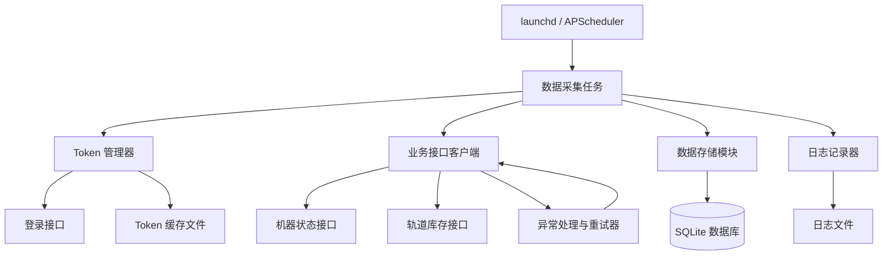

# 纪念币机后台数据自动采集系统设计方案

## 1. 项目概述

本方案用于在 Mac 电脑上定时调用纪念币机后台管理系统的接口，自动完成登录、获取 Token、拉取机器状态与轨道库存数据，并将数据持久化到本地 SQLite 数据库。所有任务由 macOS 原生 launchd 或 Python APScheduler 触发，无需人工干预。

## 2. 技术选型

| 模块 | 选型 | 理由 |
| --- | --- | --- |
| 开发语言 | Python 3.10+ | 生态丰富，适合快速开发接口脚本 |
| HTTP 客户端 | httpx | 支持异步与同步，自动重试，比 requests 更现代 |
| 定时调度 | APScheduler | 跨平台，支持 cron 表达式，可嵌入主进程 |
| 系统级调度 | macOS launchd | 系统原生，进程常驻消耗低，适合长期稳定运行 |
| 数据存储 | SQLite + sqlite3 | 单机场景零配置，单文件、事务支持完善 |
| 配置管理 | pydantic-settings | 类型安全，自动从环境变量/文件读取配置 |
| 日志 | loguru | 配置简单，自动轮转，可直接输出到文件 |
| 加密敏感信息 | macOS Keychain | Token 和密码不落盘，通过 keyring 库读取 |

## 3. 系统架构



核心流程：

1. 调度器触发任务。
2. TokenManager 检查本地缓存 Token 是否有效，无效则调用登录接口刷新。
3. ApiClient 使用有效 Token 并发请求机器列表、轨道库存等接口。
4. 解析响应数据，写入 SQLite。
5. 所有操作记录日志，异常时按策略重试并告警。

## 4. 项目目录结构

```
coin_machine/
├── config/                     # 配置目录
│   ├── settings.yaml           # 业务配置（URL、账号、调度时间）
│   └── .env.example            # 环境变量样例
├── src/
│   ├── __init__.py
│   ├── main.py                 # 入口脚本，支持单次执行与定时模式
│   ├── config.py               # 配置解析
│   ├── token_manager.py        # 登录与 Token 管理
│   ├── api_client.py           # 业务接口客户端
│   ├── storage.py              # SQLite 存储
│   ├── scheduler.py            # APScheduler 定时任务
│   └── logger.py               # 日志初始化
├── data/                       # 数据目录（自动创建）
│   ├── coin_machine.db         # SQLite 数据库
│   └── token_cache.json        # Token 本地缓存
├── logs/                       # 日志目录
│   └── collector.log
└── requirements.txt
```

## 5. 核心模块设计

### 5.1 配置管理 (config.py)

使用 pydantic-settings 从 YAML 文件和环境变量读取配置。需要你手动从浏览器抓包获得以下信息：

- 登录接口 URL、请求方法、参数格式（JSON/表单）
- Token 在响应中的字段名
- 机器列表接口 URL
- 轨道库存接口 URL（含路径参数）
- HTTP 请求头（如 User-Agent、Referer）

`config/settings.yaml` 示例：

```yaml
app:
  run_mode: once
  interval_minutes: 60

api:
  base_url: "https://admin.example.com"
  login_path: "/api/login"
  machine_list_path: "/api/machines"
  track_stock_path: "/api/machine/{machine_id}/tracks"
  login_method: "POST"
  login_data_type: "json"
  token_field: "data.token"
  extra_headers:
    User-Agent: "Mozilla/5.0 (Macintosh; Intel Mac OS X 10_15_7)"
  request_timeout: 30

credentials:
  username: "your_username"
  password: "your_password"

storage:
  db_path: "data/coin_machine.db"

schedule:
  timezone: "Asia/Shanghai"
  cron: "0 3 * * *"
```

`.env.example`：

```
COIN_MACHINE_USERNAME=your_username
COIN_MACHINE_PASSWORD=your_password
```

实现见仓库 `src/config.py`。

### 5.2 Token 管理 (token_manager.py)

负责登录、缓存 Token、判断 Token 是否过期、自动刷新。实现见 `src/token_manager.py`。

### 5.3 业务接口客户端 (api_client.py)

封装对机器列表、轨道库存等接口的请求，支持 401 自动重新登录与网络重试。实现见 `src/api_client.py`。

### 5.4 数据存储 (storage.py)

使用 SQLite，采用「先建表，再批量写入」；写入失败时备份到 `data/failed_writes/*.json`。实现见 `src/storage.py`。

### 5.5 定时调度 (scheduler.py)

- APScheduler 进程内调度：适合脚本长期运行在后台。
- 单次执行函数 `run_collection_job`：配合 macOS launchd 定时调用。

实现见 `src/scheduler.py`。

### 5.6 入口脚本 (main.py)

统一管理单次执行和定时执行两种模式。实现见 `src/main.py`。

### 5.7 日志配置 (logger.py)

使用 loguru，按天轮转，同时输出到终端和文件。实现见 `src/logger.py`。

## 6. 数据库设计

使用单表 `machine_snapshot`，每次采集追加记录，支持按时间序列分析库存变化。

| 字段 | 类型 | 说明 |
| --- | --- | --- |
| id | INTEGER PRIMARY KEY AUTOINCREMENT | 自增主键 |
| machine_id | TEXT NOT NULL | 机器编号 |
| machine_name | TEXT | 机器名称 |
| track_id | TEXT | 轨道 ID |
| track_name | TEXT | 轨道名称 |
| stock | INTEGER | 当前库存数量 |
| capacity | INTEGER | 轨道容量，可选 |
| collection_time | TEXT | 采集时间，格式 YYYY-MM-DD HH:mm:ss |

常用查询示例：

```sql
-- 查看某台机器最新库存
SELECT * FROM machine_snapshot
WHERE machine_id = 'SN001'
AND collection_time = (SELECT MAX(collection_time) FROM machine_snapshot WHERE machine_id = 'SN001');

-- 查看库存趋势
SELECT collection_time, SUM(stock) as total_stock
FROM machine_snapshot
GROUP BY collection_time
ORDER BY collection_time;
```

## 7. 异常处理与重试机制

- **网络错误**：捕获 `httpx.HTTPError` 后最多重试 3 次，间隔递增。
- **登录凭证错误**：记录日志，不发重复请求，等待下次调度。
- **Token 过期**：接口返回 401 时主动清除缓存并重新登录，重试一次。
- **数据库写入失败**：回滚当前事务，保留原始数据到临时 JSON 文件，防止丢失。
- **数据为空**：正常记录日志，不做处理。

## 8. 部署与运行

### 8.1 环境准备

```bash
cd coin_machine
python3 -m venv .venv
source .venv/bin/activate
pip install -r requirements.txt
```

### 8.2 配置填写

- 编辑 `config/settings.yaml`，填入抓包获得的接口路径、请求方式、Token 字段路径。
- 创建 `.env` 文件，写入真实账号密码。
- 如使用 macOS Keychain 存储密码，可配置 `credentials.keychain_service`。

### 8.3 单次运行验证

```bash
python src/main.py --mode once
```

运行后检查 `data/coin_machine.db` 是否有数据。

### 8.4 定时运行

推荐使用 macOS launchd，避免 Python 进程长期驻留。示例 plist 见 `deploy/com.coinmachine.collector.plist.example`。

加载任务：

```bash
launchctl load ~/Library/LaunchAgents/com.coinmachine.collector.plist
```

## 9. 安全与合规

- 不要在代码中明文保存密码，建议使用环境变量或 macOS Keychain。
- Token 缓存文件权限设为 600：`chmod 600 data/token_cache.json`
- 采集频率不要过高，避免对服务器造成压力以及触发风控。
- 自动化操作前请确认是否符合平台服务条款，避免账号异常。

## 10. 后续扩展建议

- 增加前端页面，用 Flask/FastAPI 提供库存查询界面。
- 增加告警通知：当某轨道库存低于阈值时，通过钉钉/邮件/企业微信推送。
- 使用 Pandas 对历史数据做趋势分析，生成图表。
- 将数据同步到远端 MySQL/PostgreSQL，方便多设备共享。
- 如果接口有防爬机制，可引入 Playwright 模拟浏览器登录获取更稳定的 Token。

以上文档可直接作为开发依据。你只需要把从浏览器开发者工具中获取到的真实接口路径、请求参数和响应结构填入 `settings.yaml`，运行一次单次模式验证即可。
